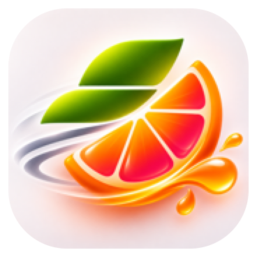

# Cara

**An open-source Nintendo 3DS emulator for handhelds, phones, tablets, and desktops.**

Cara brings your 3DS games to the screens you play on. Android is our next
major focus. We’re tuning OpenGL ES on real handhelds and bringing the game
library, controls, and play settings closer together across platforms.

[Android preview builds](https://github.com/dmikey/cara/actions/workflows/android.yml) ·
[Releases and prereleases](https://github.com/dmikey/cara/releases) ·
[Report an issue](https://github.com/dmikey/cara/issues)

## Play on your device

| Platform | What’s available |
| --- | --- |
| **Android** | ARM64 developer previews with hardware-accelerated OpenGL ES and Dynarmic JIT. The RG Slide is one of our test devices. |
| **iPhone and iPad** | A native touch-first app with game import through Files, customizable controls, and OpenGL ES. |
| **macOS** | A native launcher for Apple Silicon Macs with hardware-accelerated OpenGL and Dynarmic JIT. |
| **Linux** | A developer build with an SDL frontend and desktop OpenGL. |

Preview builds are for testing. Game compatibility, performance, and features
vary by device and platform.

## Your games, controls, and saves

- **Find your next game.** On iPad, browse your collection, favorites, and
  recently played games from the library sidebar.
- **Set up your controls.** On iPhone and iPad, use touch controls, choose
  Delta-compatible skins for portrait and landscape, or connect a supported controller.
- **Pick up where you left off.** On iPhone and iPad, use per-game save states
  and sync in-game saves through an iCloud Drive folder you select.
- **Tune your play session.** On Android and Apple devices, Accuracy Mode keeps
  the original 3DS CPU clock, while Performance Mode can adjust it under load.
- **Open compressed games.** The Apple apps support cartridge images in ZIP
  and 7z archives, as well as Z3DS files. Open a ZIP directly from Files on iPad
  or the game picker on Mac. [ZIP cartridge guide](https://github.com/dmikey/cara/blob/main/docs/native-mac-dev.md#zip-cartridge-images)

## Where Cara is headed

- **Android handhelds and phones.** We’re focusing on game compatibility,
  smoother frame pacing, and fewer shader stalls. We’re testing on real
  hardware, including the RG Slide’s Mali GPU. [RG Slide test notes](https://github.com/dmikey/cara/blob/main/docs/rg-slide-rendering.md)
- **Shared OpenGL ES improvements.** GLES is the main graphics path on Android
  and iOS. We’re improving the shared renderer so work on one platform can
  benefit the others. Metal is available in experimental Apple builds.
- **More consistent multiplatform support.** Android, iPhone, iPad, macOS, and
  Linux share an emulation core. We’re extending support and bringing more
  everyday features to each app as they’re ready.

## Build and contribute

[Build guide](docs/build.md) · [Architecture](docs/technology.md) ·
[FastInterp](docs/fastinterp.md) · [Performance](docs/performance.md) ·
[Validation](docs/validation.md)

For bug reports, include your Cara build, device, OS version, game and region,
and steps to reproduce.

## Credits and license

Cara builds on the [Citra Emulator Project](https://github.com/citra-emu),
[weihuoya’s Citra MMJ](https://github.com/weihuoya/citra), and
[Azahar](https://github.com/azahar-emu/azahar), including
[warmenhoven’s FastInterp](https://github.com/azahar-emu/azahar/pull/2376).
Save-state support builds on original Citra work by Hamish Milne and other
contributors. [Research references](docs/research-references.md) ·
[Inspection tool credits](docs/inspection-tool-attributions.md)

Cara is licensed under **GPL-2.0-or-later**. See the [license](LICENSE),
[notices](NOTICE), and [source provenance](emulator/VENDORED_SOURCE.json).
Bring your own game files. Cara ships without games, Nintendo firmware, or
keys and is an independent project.
